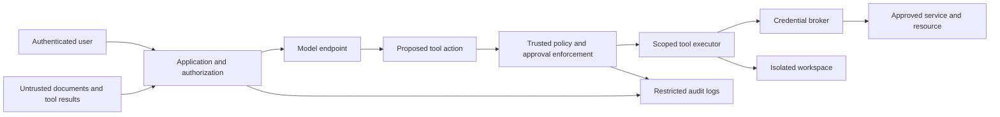

# Threat Model and Deployment Profiles

Review the full path from installation to shutdown. A model API, its management interface and the software executing tool calls may have different permissions and run in different places.

## Start with a workflow map

Record the initiating user, application, model endpoint, tools, execution environment, data stores, credential services, network routes and logging destinations. Mark where identities change and where code or untrusted content enters.

This is a conceptual separation of responsibilities, not a required network topology. A broker must authorize operations and resources, not merely attach a key to arbitrary requests. The model should never be the final permission authority.

## Select profiles

| Profile | Include when | Pay particular attention to |
| --- | --- | --- |
| cloud | A managed provider processes data or executes work | Exact account settings, delegated identities, logs, retention, provider isolation and exit |
| self-hosted | Your team operates an inference, tool or management server | Network exposure, admin routes, OS privileges, metadata credentials, patching and backups |
| agents | AI can invoke tools, execute code, browse authenticated services or change files | Tool authorization, precise approvals, execution containment, mounts, credentials and stop controls |
| rag | The system retrieves from document stores, indexes or saved knowledge | Source permissions, chunk metadata, caches, ingestion integrity and deletion propagation |

Select multiple profiles when applicable. A local agent calling a cloud model uses both **agents** and **cloud**; an internal retrieval assistant using a private inference server usually uses **rag** and **self-hosted**. Include **agents** if it takes actions through tools. Controls tagged **all** always apply; otherwise match any selected profile.

## Work through these failure scenarios

| Scenario | Boundary to verify | Relevant controls |
| --- | --- | --- |
| A dependency or scanner is replaced with malicious software | Installation/build execution cannot read production or publishing credentials | S01–S08, K02–K05 |
| An inference user attempts model import or tool registration | Administrative authority is separate from ordinary inference | N02–N03, A04 |
| A document tells an assistant to send private information elsewhere | Content cannot grant permission; retrieval and egress still enforce policy | A01–A03, N04–N05, D03 |
| An agent obtains elevated privileges inside its guest | Host files, credentials and enforcement remain outside its reach | I01–I06, K05–K06 |
| A background helper behaves differently from the shell | Every execution path has an effective boundary | I01, I05–I06 |
| Storage or a session is reused for another tenant | Old data, indexes, browser sessions and snapshots are inaccessible | I07, D04–D05, V02 |
| A valid user asks a tool to act through a stronger service account | Caller permissions survive the entire delegation chain | A01, A05, A07, D03 |
| A provider or component is compromised | Access can be revoked and the workflow recovered without reintroducing compromised artifacts | K07, S08, O03–O05, V03–V04 |

## Distinctions that change implementation

**Tool calling is not execution.** A model may emit a proposed function call. The application or tool server decides whether and how to execute it. Assess the executor's real permissions.

**A secret store is not an execution boundary.** Once a key is placed in a process environment or readable file, code in that environment may obtain it. Decide whether a scoped trusted service can perform the operation instead.

**An isolated guest can still have dangerous access.** A VM or container with broad host mounts or control sockets can expose those resources. Examine what guest administrators can reach as well as ordinary users.

**Local inference does not imply local-only data flow.** Browser automation, plugins, crash reporting, model downloads, remote fallbacks and telemetry may contact external systems. Verify actual traffic against the intended design.

**Version locking and patching are complementary.** Lock reviewed artifacts, then update deliberately. A lockfile can faithfully reproduce a compromised artifact.

**Encryption and tenant isolation solve different problems.** Encrypted storage may still be readable by a wrongly authorized workload through the application or storage layer. Review access and storage reuse separately.

## Record the decision

Document assets, adversary entry points, trust boundaries, enforced controls, test evidence, remaining risks and the accountable owner. Revisit the model when a capability or data flow changes.
